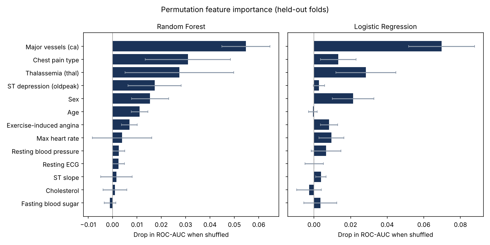

# Heart Disease Prediction Using Machine Learning and Deep Learning

A healthcare AI web application that estimates a patient's heart disease risk from 13 clinical measurements. It combines three models (Logistic Regression, Random Forest, and a neural network built in TensorFlow/Keras) and reports a **Low / Medium / High** risk level together with each model's probability.

Final year project, BSc Software Engineering, Virtual University of Pakistan.

> **Disclaimer:** this is an academic project, not a medical device. It must not be used for real diagnosis or treatment decisions.

## Features

- Three models trained on the same preprocessed data and compared side by side
- Leakage-safe cross-validation comparing two ways of handling missing data
- Explainability: permutation feature importance on held-out folds
- Neural network (ANN) with dropout regularization
- Averaged-probability risk score mapped to Low, Medium and High
- Flask web app with a login page, dashboard, prediction form, result page and about page
- Prediction history stored in MySQL, with a page to review and delete records

## Dataset

`heart.csv` has 597 patient records with 13 clinical features and a target graded 0 (no disease) to 4. Checked directly from the file:

| | Records |
| --- | --- |
| Total records | 597 |
| Records with at least one missing value | 299 |
| Complete records used for training and testing | 298 |
| Complete records, no disease (0) / disease (1 to 4) | 160 / 138 |

Because about half of the records are dropped, the 20% test set holds only around 60 patients, so single-split accuracy figures are noisy. Imputing missing values instead of dropping them is a planned improvement.

## How it works

1. **Data cleaning:** any row with a missing value (`?` or blank) is dropped, and all columns are converted to numeric. See the Dataset section for how much data this removes.
2. **Target:** the original target (0 to 4) is converted to a binary label: `0` means no disease, anything above 0 means disease.
3. **Split and scaling:** an 80/20 train/test split (`random_state=42`), then `StandardScaler` fitted on the training set only.
4. **Models:**
   - Logistic Regression
   - Random Forest
   - ANN: `Dense(16, relu)` → `Dropout(0.3)` → `Dense(8, relu)` → `Dense(1, sigmoid)`, trained with Adam and binary cross-entropy for 50 epochs (batch size 16)
5. **Prediction:** the three predicted probabilities are averaged. Below 30% is Low risk, 30% to 70% is Medium, and 70% or above is High.

### Input features

`age`, `sex`, `cp` (chest pain type), `trestbps` (resting blood pressure), `chol` (cholesterol), `fbs` (fasting blood sugar), `restecg` (resting ECG), `thalach` (max heart rate), `exang` (exercise-induced angina), `oldpeak` (ST depression), `slope`, `ca` (major vessels), `thal`

## Tech stack

Python, TensorFlow/Keras, scikit-learn, Pandas, NumPy, Flask, MySQL, HTML/CSS (Jinja templates)

## Project structure

```text
├── app.py              # Flask app: routes, MySQL history
├── models.py           # Loads trained models and makes predictions
├── train_model.py      # Cleans data, trains and saves all three models
├── evaluate.py         # Seeded, reproducible evaluation (metrics + confusion matrices)
├── cross_validate.py   # Cross-validation: drop rows vs median imputation
├── explain.py          # Explainability: permutation feature importance
├── test_data.py        # Dataset sanity checks (run with pytest)
├── MODEL_CARD.md       # Intended use, data, limitations
├── heart.csv           # Dataset
├── *_model.pkl / ann_model.h5, scaler.pkl, *_accuracy.pkl   # Saved models and scores
├── results/            # Cross-validation and explainability results
├── templates/          # HTML pages
├── static/             # Images
└── requirements.txt
```

## Getting started

1. Install dependencies:

   ```bash
   pip install -r requirements.txt
   ```

2. Make sure MySQL is running. The app reads its settings from environment variables, and the defaults suit a local setup with an empty root password. The `heart_db` database and `history` table are created automatically on first run.

   | Variable | Default | Purpose |
   | --- | --- | --- |
   | `DB_HOST` / `DB_USER` / `DB_PASSWORD` / `DB_NAME` | `localhost` / `root` / empty / `heart_db` | MySQL connection |
   | `ADMIN_USERNAME` / `ADMIN_PASSWORD` | `admin` / `123` | Demo login |
   | `FLASK_DEBUG` | `1` | Set to `0` to turn off debug mode |

   Example: `export DB_PASSWORD="your-password" ADMIN_PASSWORD="a-stronger-password"`

3. (Optional) Retrain the models. Trained models are already included, so this is only needed if you change the data or model settings:

   ```bash
   python train_model.py
   ```

   This prints the test accuracy of each model and saves the results.

4. Start the app from the project folder:

   ```bash
   python app.py
   ```

   Then open `http://127.0.0.1:5000`. Unless you set `ADMIN_USERNAME` and `ADMIN_PASSWORD`, the demo login is `admin` / `123`.

5. Run the data checks (they need only Python, no TensorFlow or MySQL):

   ```bash
   pytest
   ```

## Evaluation

`evaluate.py` repeats the cleaning and 80/20 split from `train_model.py` with every random seed fixed (seed 42), so results can be reproduced exactly. It reports accuracy, precision, recall, F1 and ROC-AUC for Logistic Regression, Random Forest, the ANN and the averaged ensemble, and saves the results to `results/metrics.md` and `results/confusion_matrices.png`.

```bash
python evaluate.py
```

`cross_validate.py` compares the two ways of handling missing data on the same models: dropping incomplete rows (298 records) versus median imputation (all 597 records). Imputation is done inside each cross-validation fold so nothing leaks from the validation data. It uses repeated stratified 5-fold cross-validation and writes `results/cv_results.md`.

```bash
python cross_validate.py          # Logistic Regression and Random Forest
python cross_validate.py --ann    # also the neural network (slower)
```

`explain.py` shows which features each model relies on, using permutation importance on held-out folds, and writes `results/feature_importance.md` and `results/feature_importance.png`.

```bash
python explain.py
```

For a screening task like this, recall (how many true disease cases are caught) matters at least as much as accuracy, so check the confusion matrices rather than accuracy alone.

## Results

### Cross-validated performance

From `cross_validate.py` (repeated stratified 5-fold cross-validation, 15 folds, seed 42). Mean ± standard deviation across folds:

| Data handling | Model | Accuracy | Recall | F1 | ROC-AUC |
| --- | --- | --- | --- | --- | --- |
| Drop incomplete rows (n=298) | Logistic Regression | 0.833 ± 0.040 | 0.790 ± 0.093 | 0.812 ± 0.055 | 0.902 ± 0.046 |
| Drop incomplete rows (n=298) | Random Forest | 0.822 ± 0.057 | 0.763 ± 0.085 | 0.798 ± 0.068 | 0.903 ± 0.037 |
| Median imputation (n=597) | Logistic Regression | 0.839 ± 0.031 | 0.771 ± 0.048 | 0.797 ± 0.039 | 0.897 ± 0.023 |
| Median imputation (n=597) | Random Forest | 0.829 ± 0.019 | 0.747 ± 0.045 | 0.781 ± 0.026 | 0.895 ± 0.021 |

**What this shows:** keeping all 597 records with median imputation gives about the same average performance as dropping half of them, but the results vary much less between folds (for example, Logistic Regression ROC-AUC spread falls from ±0.046 to ±0.023). The estimates are more reliable, which supports moving the deployed models to imputation. Recall stays below precision for both models, so missed disease cases remain the main weakness to work on. Full table: [`results/cv_results.md`](results/cv_results.md).

### Which features drive the predictions

From `explain.py`: permutation importance measured on held-out folds (drop in ROC-AUC when a feature is shuffled).



Both models rely most on the number of major vessels (`ca`), chest pain type (`cp`), thalassemia (`thal`) and sex, while cholesterol and fasting blood sugar contribute little. Agreement between a linear and a tree-based model makes these findings more credible than either model alone. Details and Logistic Regression coefficients (direction of each effect): [`results/feature_importance.md`](results/feature_importance.md).

> These scikit-learn results were reproduced with scikit-learn 1.9. Run `python evaluate.py` for the held-out metrics of all three models, including the ANN and the ensemble.

## Responsible use

- Predictions are probabilities from small models trained on limited data. They support learning and discussion, not clinical decisions.
- Model performance has not been checked across age or sex groups, or on data from other hospitals or countries, so it may not generalize.
- Patient names and inputs are stored in a local MySQL database. A real deployment would need consent, access control and data-protection compliance (for example GDPR in Europe).

## Limitations

- The login is a single shared demo account with a plain-text password, not real authentication. Do not deploy this as is.
- The deployed models are trained on a single train/test split with no hyperparameter search. Cross-validated estimates are in the Results section.
- Only 298 complete records are used and the test set is about 60 patients, so results will vary a lot between splits.
- The three-level risk bands are a simple threshold on the averaged probability, not a trained multiclass model.

## Planned improvements

- Hyperparameter search (cross-validation is already available in `cross_validate.py`)
- Probability calibration and a proper multiclass or ordinal model for risk levels
- Per-patient explanations (for example SHAP) on top of the global feature importance in `explain.py`
- Fairness checks across age and sex, and validation on an external dataset
- Retrain the deployed models with imputation if `cross_validate.py` shows it helps, instead of dropping about half of the records
- Real authentication with hashed passwords and per-user accounts

## Author

**Rizwan Ali**, AI Engineer Intern and aspiring AI researcher  
[GitHub](https://github.com/rizwannazir333) · [LinkedIn](https://linkedin.com/in/rizwan-ali-ai-engineer)
